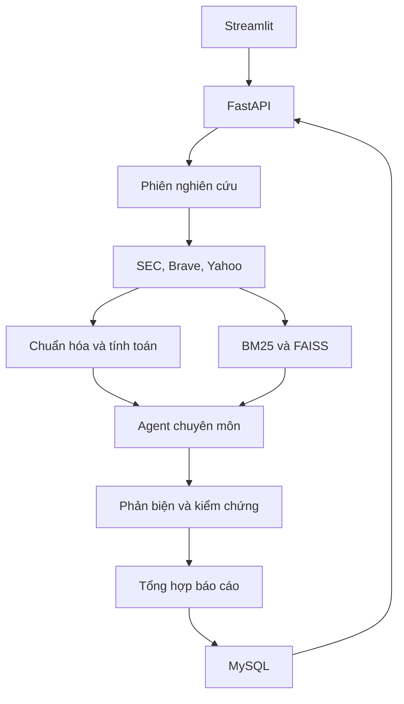
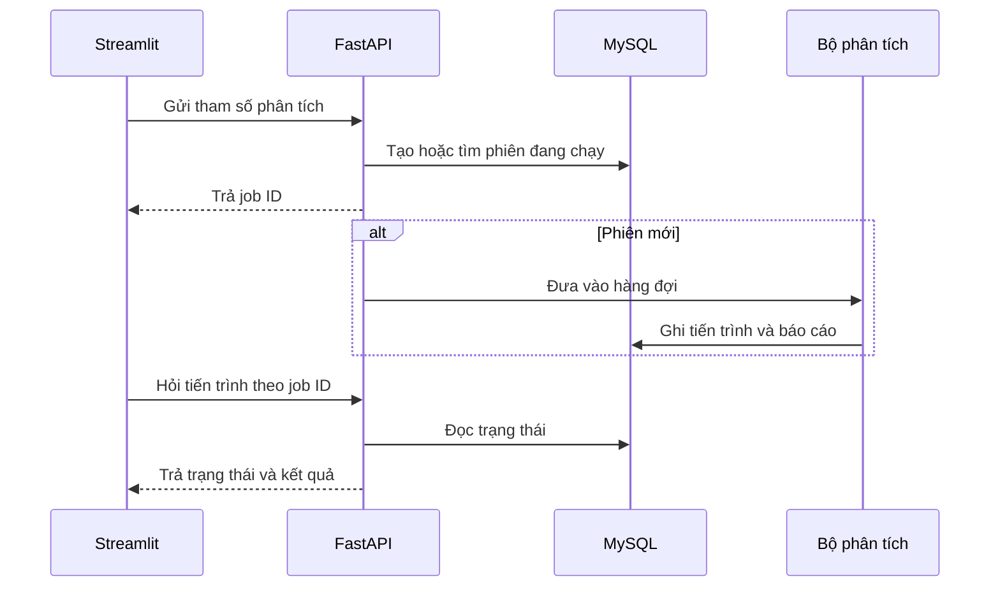

# Kiến trúc và vận hành

| Thành phần | Trách nhiệm |
|---|---|
| `finsight/sec.py` | Danh mục ticker/CIK, hồ sơ nộp, các Form 10-K, 10-Q, sửa đổi, proxy và Company Facts. |
| `finsight/research.py` | Tạo truy vấn, Brave Web và LLM Context, DDGS tùy chọn, tải và tách tài liệu được phép. |
| `finsight/financials.py` | Chuẩn hóa XBRL, nhận diện loại kỳ, ghi thay đổi, tỷ số và DCF. |
| `finsight/rag.py` | BM25 và FAISS, xếp hạng RRF, lọc CIK và thời điểm trước truy xuất. |
| `finsight/agents.py` | SDK Google GenAI, bốn vai trò chuyên môn, phản biện, kiểm chứng độc lập theo từng lượt và chọn ID tổng hợp. |
| `finsight/verification.py` | Kiểm tra trích đoạn, số học, thời gian, nguồn trái chiều và độ bao phủ. |
| `finsight/pipeline.py` | Điều phối, ghi tiến trình, giới hạn chi phí theo số lượt, biên soạn snapshot. |
| `finsight/storage.py` | MySQL, transaction, ràng buộc, truy vấn theo thời gian và lưu vết. |
| `finsight/reporting.py` | Xuất Markdown, JSON và PDF Unicode có liên kết. |

## Vòng đời một phiên

## Dữ liệu lưu trữ

- `research_runs` lưu trạng thái, input, ngày UTC, khóa job đang chạy và thời gian hết hạn. `pipeline_events` lưu tiến trình.
- `companies` lưu hồ sơ theo CIK. `analysis_reports` lưu một snapshot gồm filings, các fact/ratio theo thời điểm, agents, điểm bao phủ, sử dụng API và giới hạn. Snapshot dùng JSON để giữ cấu trúc và khả năng tái lập theo phiên.
- `analysis_claims`, `document_chunks` và `claim_evidence` lưu trạng thái, đoạn và quan hệ. `user_feedback` lưu phản hồi. Chunks có hash và ID ghép tài liệu/vị trí. Chỉ giữ toàn văn đoạn đã trích làm bằng chứng, các đoạn còn lại giữ metadata. FAISS dùng vị trí trong danh sách tương ứng và dựng lại trong RAM mỗi lần chạy.
- Chi phí ước tính chỉ hiển thị khi có đơn giá cho toàn bộ nhóm lượt gọi/token đã ghi nhận. Không bao gồm thuế, lượt phát sinh ngoài ứng dụng hoặc biểu giá theo bậc.
- Dữ liệu Yahoo chỉ lưu khi `PERSIST_MARKET=true`. Brave chỉ xuất URL trong bộ nhớ để tìm nguồn gốc. Snippet và metadata do Brave tạo không được đưa vào prompt hoặc database.
- Dùng một backend worker cho triển khai cục bộ. Job cùng cấu hình đang hoạt động trả lại ID cũ. Nếu tiến trình bị dừng, lease hết hạn và lần truy vấn sau đánh dấu job lỗi. Người dùng có thể chạy lại cùng input.
- Việc kiểm tra URL thực hiện khi bấm nút. Báo cáo giữ ảnh chụp bằng chứng đã dùng ở lần phân tích đó.

## API

| Phương thức và đường dẫn dưới `/api/v1` | Kết quả |
|---|---|
| GET `/health`, `/system/status`, `/dashboard` | Trạng thái MySQL, migration và cấu hình. |
| GET `/companies/search?q=...` | Ticker và CIK từ SEC. |
| GET `/companies/{cik}`, `/companies/{cik}/financials` | Snapshot đã lưu theo CIK. |
| POST `/analysis` | Gửi ticker, as_of, years, mode, search_budget và peers. Nhận job ID. |
| GET `/analysis/{id}`, `/analysis/{id}/progress` | Trạng thái và sự kiện. |
| GET `/analysis/{id}/claims`, `/analysis/{id}/evidence` | Nhận định và bằng chứng. |
| POST `/analysis/{id}/evidence/{evidence_id}/check` | Kiểm tra URL nguồn. |
| GET `/reports`, `/reports/{id}` | Lịch sử có bộ lọc và báo cáo. |
| GET `/reports/{id}/export?format=md` | Markdown, JSON hoặc PDF. |
| POST `/reports/{id}/rerun`, `/reports/{id}/feedback` | Chạy lại hoặc lưu phản hồi. |
| DELETE `/reports/{id}` | Xóa phiên đã kết thúc. |
| POST `/valuation/dcf` | Tính DCF theo input và độ nhạy. |

## Tài liệu tích hợp

[SEC EDGAR APIs](https://www.sec.gov/search-filings/edgar-application-programming-interfaces), [SEC Fair Access](https://www.sec.gov/about/developer-resources), [Brave Web Search](https://api-dashboard.search.brave.com/documentation/services/web-search), [Brave LLM Context](https://api-dashboard.search.brave.com/documentation/services/llm-context), [Gemini Structured Outputs](https://ai.google.dev/gemini-api/docs/structured-output).
